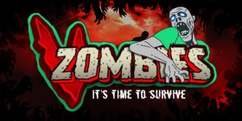

# nanos-vzombies
### Compatible with nanos >= 1.166.2

Press **H** to open the in-game *How to play* menu.

## Dependencies
* [vzombies-assets](https://nanos-world.com/store/assets/vzombies-assets)
* [default-weapons](https://github.com/nanos-world/default-weapons)

## Integrations
* [default-vehicles](https://github.com/nanos-world/default-vehicles)
* [modern-weapons](https://github.com/vugi99/nanos-modern-weapons)
* [webui3d2d](https://github.com/Timmy-the-nobody/WebUI3d2d)
* [mapvote](https://github.com/vugi99/nanos-mapvote)
* [vzombies-survivors-assets](https://nanos-world.com/store/assets/vzombies-survivors-assets)

## Global Features
* [Zombies](#zombies)
* [Bosses](#bosses)
* Perks (Juggernog, Quick Revive, Speed Cola, Double Tap, Stamin-Up, Three Gun / Mule Kick)
* Powerups (Insta-Kill, Max Ammo, Nuke, Carpenter, Double Points, Death Machine)
* Pack a Punch + Repack upgrades (Elemental ammo types)
* Wunderfizz
* Scoreboard (`Tab`)
* Spectator
* Weapons inventory & Grenades
* Knife (`V`)
* Mystery Box
* Teleporters
* Barricades
* Gibs (Shootable limbs as physics props)
* Revive system
* [Player Bots](#bots)
* Ping (`F`)
* Player Settings (`O`)
* Banks
* Vehicles support
* Chargers
* Pause Game (`P` - Host)
* Rich Presence (Steam, Discord)
* Dynamic 3D Audio & Sound Falloff

## Togglable Features
* Leaderboards (`I`)
* Levels/XP System

## Server/Dev Features
* Admin Menu (`U`) — Skip rounds, start map votes, kick, ban, chat/VOIP mute
* Mod Menu (`M`) — Development tools, cheat toggles, spawn weapons/perks/enemies
* Dev Mode (`DEV_MODE` setting in `Package.toml`)

## Zombies
Also called enemies, their eyes glow and appear in multiple variations (Walkers, Sprinters, Crawlers, Hellhounds):
* **Dismemberment & Gibs:** Precision gunfire can dismember arms, legs, and heads into interactive physics props you can pick up and toss.
* **Headshots:** Deal increased multiplier damage.
* **Audio cues:** Directional groans, footsteps, and rear-approach warning alerts.

## Bosses
### Brutus
Armored behemoth wielding a barbed baseball bat. He possesses a massive health pool (4x base health), sprints aggressively toward players, and delivers devastating melee attacks (70 damage) capable of breaching barricades and defensive lines. Spawns beginning at round 10.

### Napalm
Volatile, blazing boss enveloped in an infernal aura that continuously scorches nearby players. Deals massive single-target melee damage (100 damage) and violently detonates upon death, causing lethal area-of-effect blast damage. Spawns starting at round 10.

### Business Grabber
A suited zombie boss with a dangerous wrestling grab mechanic. When closing the distance, it tackles and pins survivors in place for 3.5 seconds, locking their movement and aim (or forcibly pulling them out of vehicles), leaving them helpless against surrounding hordes. Has 2x base health and spawns starting at round 8.

### Skeleton Knight
An armored undead knight that hunts survivors using acoustic sound tracking (`noise` detection) rather than standard vision, zeroing in on player footsteps and gunfire. Wields a melee blade with heavy scaling slash damage. Has 3x base health and spawns starting at round 15.

## Bots
* **Goal Oriented:** Autonomously navigates the map, buys wall weapons, drinks perks, upgrades at Pack-a-Punch, collects powerups, and rebuilds broken barricades.
* **Inventory Management:** Actively manages weapon slots and purchases ammo refills when low.
* **Tactical Retreat:** Dynamically flees and repositions when cornered or overwhelmed by hordes.
* **Revive Prioritization:** Rushes to revive downed teammates before bleedout timers expire.
* **Bot Orders (`B`):** Radial command wheel to direct companion bots (follow, hold position, roam freely).

## Submodes
### Sharpshooter
Weapons cycle automatically at fixed intervals (60s) with bottomless reserve ammo. Be the last survivor standing to win.

### GunGame
Make enough kills with each weapon to advance through the arsenal tiers. The first player to cycle through all weapons wins.

### Invisible Zombies
The undead horde is completely invisible! Rely on spatial audio, glowing eye trails, muzzle flash reflections, and teammate pings (`F`) to track down and eliminate threats.

### Grief
A competitive last-team-standing survival mode. Direct friendly damage is disabled; instead, shooting or knifing opponents freezes them in place briefly (`2.5s`), griefing them into the path of the relentless zombie horde.

### TopDown
Converts the perspective into an overhead top-down arcade twin-stick shooter with real-time camera zoom (mouse wheel).

### PumpongUs
A social deduction survival submode inspired by *Among Us*. Zombies spawn with pumpkin heads that drop collectible pumpkins on death. One player is secretly designated as the Imposter with sabotage abilities (`C`), Imposter powers (`K`), and Goo Tentacles, while crewmates complete survival tasks and call emergency meetings to vote out suspects.

## Links
* [Mapping Guide & Prefabs](https://github.com/vugi99/vzombiesMapping)
* [Community Wiki](https://github.com/vugi99/nanos-vzombies/wiki)
